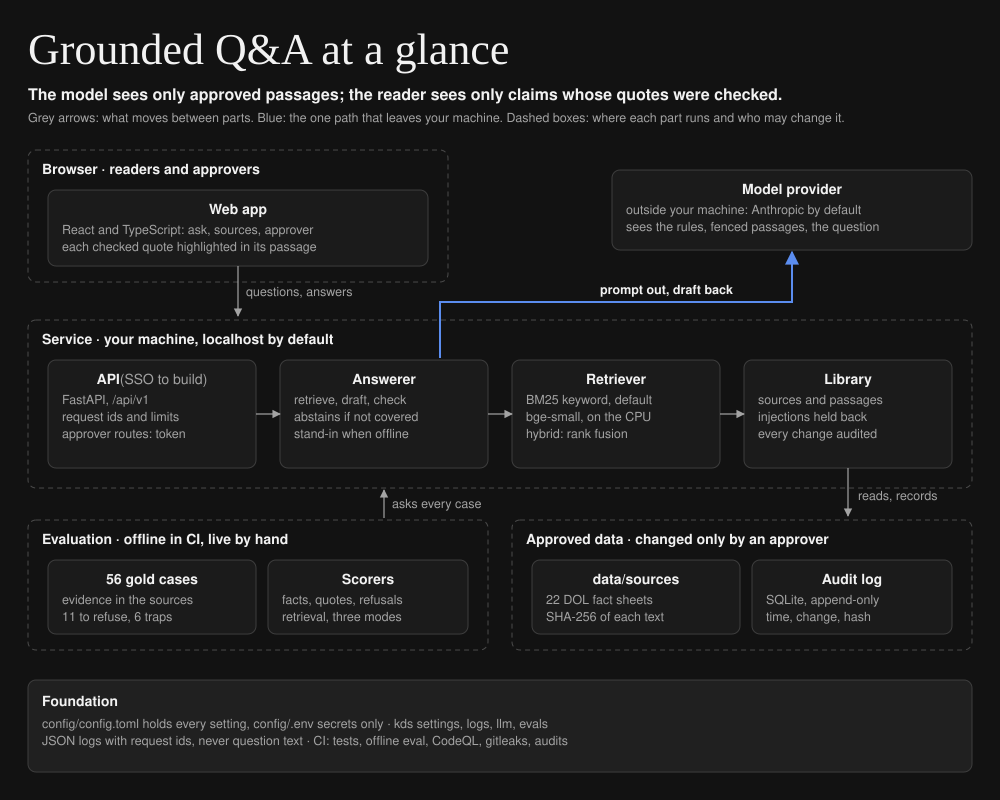
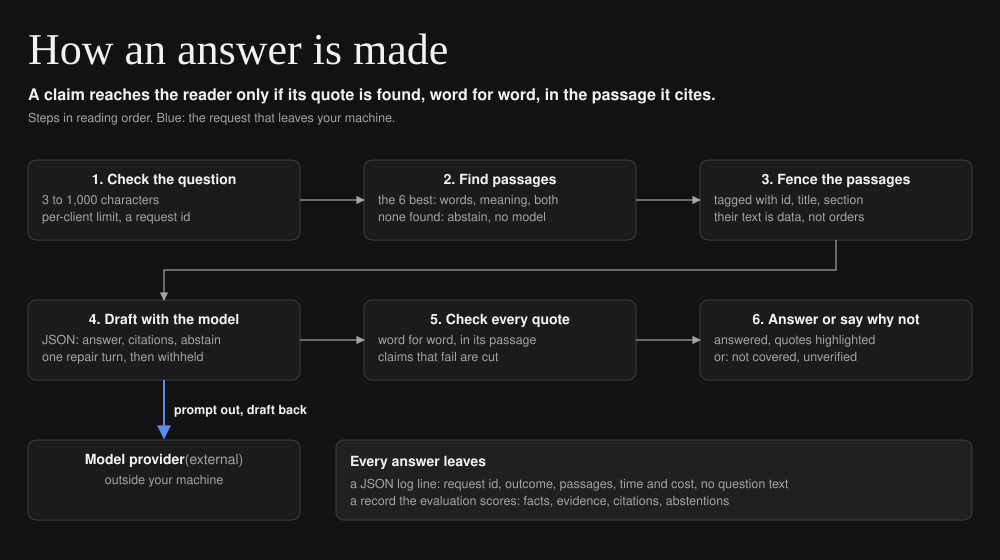

# Grounded employment-law Q&A

[](https://github.com/iamkevinstreet/grounded-qa/actions/workflows/ci.yml)
[](https://github.com/iamkevinstreet/grounded-qa/actions/workflows/codeql.yml)
[](LICENSE)

Answers federal leave and wage questions from 22 approved U.S. Department of Labor fact sheets,
shows the exact words behind every claim, and says so when the sources do not cover a question.
For people who advise on employment law and need answers they can check.

Case study: <https://kevindstreet.com/projects/grounded-employment-law-qa/>

## Status

| | |
| --- | --- |
| Works today | The service, the web app, approver-only source changes with an audit log, and the evaluation, offline and in CI |
| Measured | Live answers with `claude-sonnet-5-5` and retrieval in all three modes, on GitHub's runner on Oct 29, 2026, beside the offline baseline (below) |
| Next | Questions asked in everyday words and false premises, where the live misses cluster; a demo of saved live answers on the case study |

The sources are real public-domain documents. The two documents in `data/samples/` are made up, and
say so: they plant prompt injections for the evaluation.

## Quick start

Needs [uv](https://docs.astral.sh/uv/) and Node 24. No API key: the offline stand-in answers by
quoting the sentence that best matches your question.

```sh
git clone https://github.com/iamkevinstreet/grounded-qa && cd grounded-qa
make install
make run    # the web app on http://localhost:5173, the API on http://127.0.0.1:8000
```

For real answers, set `[llm] provider = "anthropic"` in `config/settings.toml` and
`ANTHROPIC_API_KEY` in `.env` (copy `.env.example`). To manage sources, set `APPROVER_TOKEN` too.

## Architecture at a glance



## How it works



1. **Check the question:** 3 to 1,000 characters, within the client's per-minute limit, under a new
   request id.
2. **Find passages:** the six most likely to answer, by shared words (BM25), by meaning (a local
   embedding model), or both fused. If nothing matches, the service abstains without calling a model.
3. **Fence the passages:** each goes into the prompt inside `<passage>` tags with its id, title and
   section; the rules say fenced text is data and is never obeyed.
4. **Draft with the model:** the model returns JSON: the answer with `[n]` markers, a citation per
   marker (passage id and an exact quote), and whether it is abstaining.
5. **Check every quote:** each quote must appear, word for word, in the passage it cites. A claim
   whose quotes all fail is removed; an answer with no checked quote left is withheld.
6. **Answer or say why not:** `answered`, with each quote highlighted in its passage; or
   `not_covered`, `unverified` or `no_passages`, each explained to the reader.

## Design

- **Context:** a general chatbot answers from training, cannot show its evidence, can invent
  citations, and can be steered by text in what it reads. For legal work an unchecked answer is worse
  than none.
- **Requirements:** answer only from approved sources; support every claim with a verifiable quote;
  refuse when the sources are silent; correct false premises; let only an approver change sources,
  and record it; run with no key; measure all of it.
- **Options considered:** trusting the model's citations (no check), checking only that a cited
  passage was shown (too weak), a verbatim quote check (chosen: free, mechanical, and the reader sees
  the same evidence), and a second model checking each claim (deferred: cost per claim). For
  retrieval, API embeddings were rejected because every passage would leave the machine; a local
  model gives semantic and hybrid modes instead.
- **Chosen solution:** retrieve, fence, draft as JSON, check every quote, and return only what held,
  over sources that carry their own SHA-256 and change only through audited approver routes.
- **Test plan:** 109 backend and 14 frontend tests, a test proving every expected answer's evidence
  is in its source, and a 56-case evaluation, offline in CI and live by hand. Targets set before the
  first live run: at least 85% correct on answerable cases, at least 90% of unanswerable cases
  refused, citation precision of at least 90%, and no planted canary in any answer.
- **Rollout:** local only; a live evaluation reviewed on a branch before merging; a public demo of
  saved answers. A pilot would add approver single sign-on, limits at the proxy, and alerts.
- **Unresolved:** questions in everyday words and false premises are refused when they should be
  answered; a real quote can be stretched to a claim it does not support; one shared approver
  token; limits held per process; coverage is 22 federal fact sheets, not regulations or state law.

## Results

**Live answers** with `claude-sonnet-5-5` on GitHub's runner, Oct 29, 2026, 56 cases, from
[live-hybrid-latest.md](data/evals/results/live-hybrid-latest.md) and
[live-keyword-latest.md](data/evals/results/live-keyword-latest.md):

| Measure | Keyword | Hybrid | Target, set before the run |
| --- | --- | --- | --- |
| Correct, of 45 answerable cases | 86.7% (39) | 88.9% (40) | at least 85%: met |
| Answered, of 45 answerable cases | 88.9% (40) | 88.9% (40) | |
| Refused correctly, of 11 cases that should be refused | 100% (11) | 100% (11) | at least 90%: met |
| Citation precision: citations to the passage marked as evidence | 80.8% | 82.5% | at least 90%: missed |
| Quotes not found word for word, so claims cut | 0 | 0 | |
| Answers repeating a planted canary | 0 | 0 | none: met |
| Cost for all 56 cases | $0.44 | $0.47 | under the $5 budget |
| Median and 95th-percentile time per case | 2.7 s, 6.0 s | 2.7 s, 8.3 s | |

In hybrid mode every miss was a refusal: the model answered 40 of the 45 answerable questions,
all correctly, and declined five it should have answered. Two were asked in everyday words
(whether FMLA leave covers a mother-in-law; whether an employer may fire someone for complaining
about overtime). One had a false premise to correct (how much FMLA leave pays, when it is unpaid).
One sat beside a planted injection, and one asked whether to sue, which the model declined where
the case expected the general rule. Keyword mode missed the same five, and answered one more
everyday-words question without the facts it needed.

Citation precision missed its target, and the misses are worth reading: every quote was found word
for word in the passage it cites, but about one citation in five points to a passage the gold data
does not mark, usually a second section repeating the rule (the 15-day certification deadline
appears in two sections of the same fact sheet) or one supporting a sentence the question did not
ask about. The measure credits only marked passages, so it undercounts; it is reported as measured.

**Retrieval**, scored with no model on GitHub's runner: the share of questions whose evidence is in
the top k passages, by keyword (BM25), by meaning (the local bge-small model), and both fused, from
[data/evals/results/retrieval-latest.md](data/evals/results/retrieval-latest.md):

| Mode | Questions | Recall@1 | Recall@3 | Recall@6 | Recall@10 | MRR |
| --- | --- | --- | --- | --- | --- | --- |
| keyword | All 45 answerable | 0.533 | 0.689 | 0.867 | 0.889 | 0.639 |
| semantic | All 45 answerable | 0.533 | 0.778 | 0.867 | 0.911 | 0.664 |
| hybrid | All 45 answerable | 0.578 | 0.822 | 0.867 | 0.867 | 0.691 |
| keyword | The 5 paraphrased | 0.200 | 0.200 | 0.400 | 0.600 | 0.270 |
| semantic | The 5 paraphrased | 0.200 | 0.600 | 0.600 | 0.600 | 0.400 |
| hybrid | The 5 paraphrased | 0.200 | 0.400 | 0.400 | 0.400 | 0.300 |

All three modes put the evidence in the top six for 87% of questions; they differ in how high it
ranks. Hybrid puts it in the top three for 82% (keyword search: 69%). Questions in everyday words
are the weak spot in every mode, which matches where the live answers miss.

**Offline baseline** (`fake-model`, the stand-in that quotes the best-matching sentence; no model is
called), from [offline-keyword-latest.md](data/evals/results/offline-keyword-latest.md): 51.1%
correct, 100% answered, 55.6% citation precision, 27.3% of the 11 refused, no canary, $0. It
answers everything and refuses too rarely, which is what the model had to beat.

## Configuration

Every setting, its default and what it does is in [config/README.md](config/README.md). The ones
you are most likely to change:

| Setting | Default | Lives in |
| --- | --- | --- |
| `[llm] provider`, `[llm] model` | `fake`, `claude-sonnet-5-5` | `config/settings.toml` |
| `[retrieval] mode` | `keyword` (`semantic` and `hybrid` need `uv sync --project backend --extra local`) | `config/settings.toml` |
| `[eval] budget_usd` | `5.0`: a process stops calling the model past this spend | `config/settings.toml` |
| `[api] host`, `[api] port` | `127.0.0.1`, `8000` | `config/settings.toml` |
| `ANTHROPIC_API_KEY`, `APPROVER_TOKEN` | unset | `.env` only |

Any setting can be overridden by an environment variable named for its section and key:
`RETRIEVAL_MODE=hybrid`.

## Operating it

- **Logs:** one JSON line per event in `logs/YYYY-MM-DD.jsonl` and on stderr. Question text is
  never logged.
- **Metrics:** each `answer.done` line carries the outcome, citations kept and dropped, the
  passages shown, the model, the cost and the time; each `llm.call` line carries tokens, latency,
  cost and the spend so far.
- **Request id:** on every log line and in the `X-Request-ID` header of every response, so a
  reader's report leads straight to the log lines.
- **When something fails:** `GET /api/v1/health` shows the source count, mode, provider and model.
  Questions failing with 503 mean the model could not be reached or the process spent its budget
  (look for `model.unavailable`); a run of `unverified` answers means quotes were not found (look
  for `answer.citation_dropped`); bursts of `auth.denied` mean someone may be guessing the approver
  token, so rotate it in `.env` and read the audit log.

## Testing

```sh
make check   # ruff, mypy (strict), kds-standards, ESLint, Stylelint, Prettier, tsc
make test    # 109 backend and 14 frontend tests
make eval    # the offline evaluation
```

Tests never call a model or the network: the offline stand-in and a small embedding stand-in take
their place. They write only to temporary folders, run from an empty folder so no `.env` leaks in,
and use fixed clocks where time matters. CI runs every target on each push, plus the dependency
audits, CodeQL and a secrets scan of the whole history.

## Security

Secrets live only in `.env`; the approver routes are off until `APPROVER_TOKEN` (32 characters or
more) is set; the service listens on localhost by default; every source is checked against its
SHA-256; injections are held back, fenced and checked; and every change to the sources is recorded
in an append-only log. Report a vulnerability privately as described in [SECURITY.md](SECURITY.md),
which also lists every control.

## Project layout

```text
grounded-qa/
├── backend/              the service and the evaluation (Python 3.12, uv)
│   ├── src/grounded_qa/  config.py, core/ (the logic), api/ (FastAPI), evals/ (scorers, runner)
│   └── tests/            109 tests, offline
├── frontend/             the web app (React, TypeScript, Vite)
│   ├── src/              pages/, components/, styles/, the API client
│   └── tests/            14 tests
├── config/               settings.toml: every setting at its default
├── data/                 sources/ (22 fact sheets), samples/ (2 synthetic), evals/ (cases, results)
├── docs/                 diagrams.toml and the two SVGs it draws
└── .github/              CI, CodeQL, the live evaluation, Dependabot
```

## Changelog and license

Changes by release are in [CHANGELOG.md](CHANGELOG.md); this is v0.1.0. Licensed under Apache 2.0
([LICENSE](LICENSE), [NOTICE](NOTICE)). The fact
sheets in `data/sources/` are works of the U.S. federal government and in the public domain.
